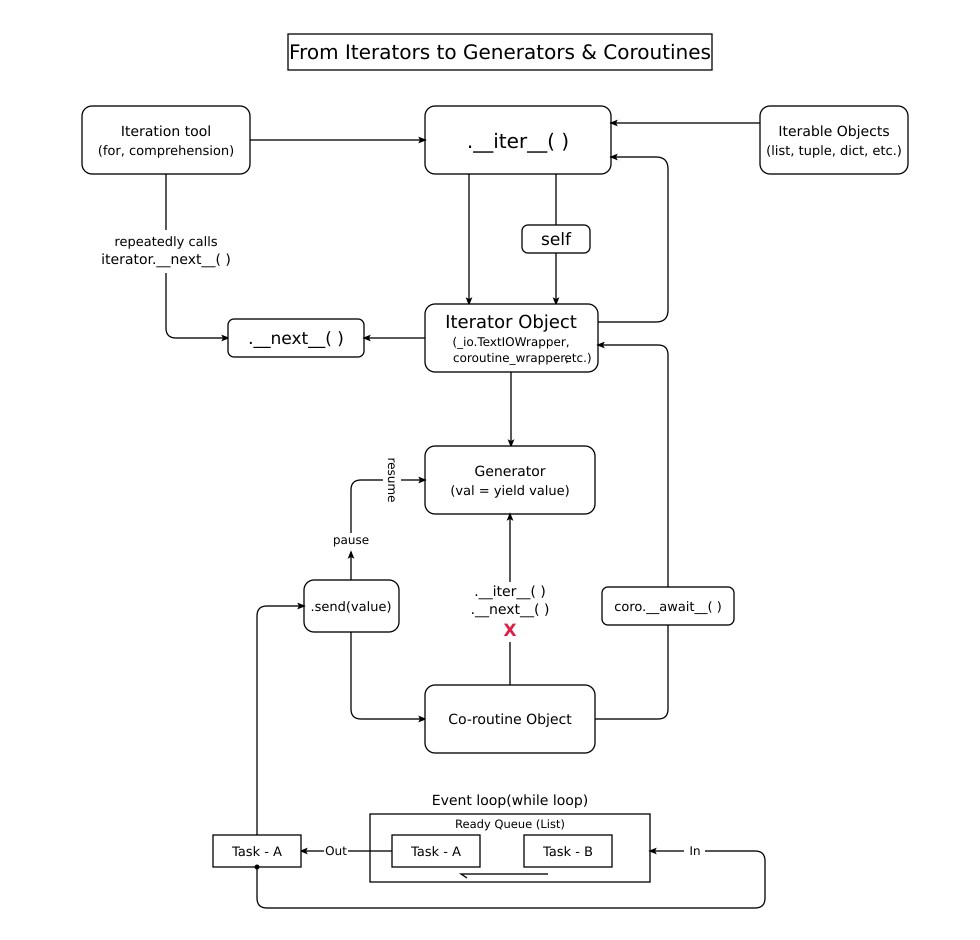

# From Iterators to Generators & Coroutines



This document breaks down the complete internal architecture and evolution of Python's iteration protocol into generators, native coroutines, and the `asyncio` event loop, directly referencing the visual flow in `./assets/Iterator_to_Async_coroutines.svg`.

---

## 1. The Iteration Protocol (`Iterable` $\rightarrow$ `.__iter__()` $\rightarrow$ `Iterator Object`)

At the top of the architecture, Python separates **containers of data** from the **stateful cursors** that traverse them:

* **Iterable Objects (`list`, `tuple`, `dict`, etc.):**
  An object is iterable if it implements `.__iter__()`. Calling `iter(iterable)` (done automatically by iteration tools like `for` loops and comprehensions) invokes `iterable.__iter__()`, which instantiates and returns a brand-new **Iterator Object** (e.g., `list_iterator`, `dict_keyiterator`).
* **Iterator Object (`_io.TextIOWrapper`, `coroutine_wrapper`, etc.):**
  An iterator manages traversal state and implements **both** `.__iter__()` and `.__next__()`:
  1. **`iterator.__next__()`:** The iteration tool (`for` loop, list comprehension) repeatedly calls `iterator.__next__()` to fetch elements one by one until `StopIteration` is raised.
  2. **The `self` Loop (`iterator.__iter__() -> self`):** If you pass an existing `Iterator Object` directly into a `for` loop, Python still calls `.__iter__()` on it first. As shown by the right-hand loop passing through the `self` box, an iterator's `.__iter__()` method simply returns `self` (its own instance) so it can be consumed directly inside any iteration tool.

---

## 2. Generators: Two-Way Stateful Iterators (`val = yield value`)

Moving down from `Iterator Object` to `Generator`:

* **Every Generator is an Iterator:** When a Python function contains the `yield` keyword, calling it returns a **Generator** object that automatically implements the iterator protocol (`.__iter__()` and `.__next__()`).
* **Two-Way Execution (`pause` & `resume` via `.send(value)`):**
  Unlike standard one-way iterators that only produce values, generators introduce two-way communication through `val = yield value` and `.send(value)`:
  * **`pause` (Yielding Out):** When execution hits `yield value`, the generator freezes its local stack frame, yields `value` back to the caller, and pauses.
  * **`resume` (Sending In):** Calling `gen.send(value)` resumes the paused generator frame and assigns the sent argument directly to `val` on the left side of `val = yield value`. *(Note: Calling `next(gen)` is equivalent to calling `gen.send(None)`).*

---

## 3. Native Coroutines (`async def`) & `coro.__await__()`

In the lower half of the diagram, Python evolves generators into **Co-routine Objects** (`async def`):

* **Blocking Accidental Iteration (`__iter__()` / `__next__()` $\rightarrow$ $\times$):**
  Even though native coroutines share the exact same internal pause/resume frame engine as generators, Python intentionally removes `.__iter__()` and `.__next__()` from `Co-routine Object` (indicated by the red $\times$). This prevents developers from accidentally iterating over an `async def` coroutine inside a regular synchronous `for` loop.
* **The `coro.__await__()` Bridge:**
  When you `await` a coroutine, Python invokes `coro.__await__()`. As shown by the arrow routing from `coro.__await__()` directly up into the right side of `Iterator Object`, `coro.__await__()` returns a `coroutine_wrapper`—which **is** an `Iterator Object`! This bridges `async/await` back into the underlying iterator/generator machinery.
* **Driving Coroutines via `.send(value)`:**
  Just like generators, a `Co-routine Object` is stepped forward by calling `.send(value)` (typically `.send(None)`).

---

## 4. The Event Loop (`while` loop & FIFO Ready Queue)

At the base of the diagram sits the **`Event loop (while loop)`**, which orchestrates concurrent execution using a **Ready Queue (List)**:

1. **Dequeue (`Out`):** The event loop pulls the next runnable task (`Task - A`, which wraps a `Co-routine Object`) out of the front of the `Ready Queue`.
2. **Step Execution (`.send(value)`):** `Task - A` routes up to `.send(value)`, advancing its underlying coroutine until it hits an `await` point (which yields control and pauses).
3. **Re-queue (`In`):** If `Task - A` is not yet finished (it yielded a pending future/IO operation rather than raising `StopIteration`), it loops around the bottom track (`In`) back into the tail of the `Ready Queue` behind `Task - B`, allowing cooperative multitasking on a single thread.

---

## Quick Verification Script

You can verify every box and arrow in the diagram with this standalone Python script:

```python
import inspect
from collections.abc import Iterator

# 1. Iterable vs Iterator & the `self` loop
nums = [1, 2, 3]                          # Iterable Object
iterator = nums.__iter__()                # Returns list_iterator (Iterator Object) 
assert iterator.__iter__() is iterator    # The `self` loop: iterator.__iter__() returns self 
assert iterator.__next__() == 1           # Repeatedly calls iterator.__next__()          

# 2. Generator (pause / resume with val = yield value)
def two_way_gen():
    val = yield "paused_at_1"             # Pauses & yields "paused_at_1"; resumes with `val`       
    yield f"resumed_with_{val}"

gen = two_way_gen()                       # Prime generator -> pauses at yield
first_out = gen.send(None)
second_out = gen.send("hello")            # Resumes generator, passing "hello" into `val`    
assert first_out == "paused_at_1"
assert second_out == "resumed_with_hello"

# 3. Co-routine Object & coro.__await__() -> coroutine_wrapper
async def sample_coro():
    return "done"

coro = sample_coro()
assert inspect.iscoroutine(coro)
assert not hasattr(coro, "__iter__")       # Blocked (__iter__ / __next__ X)
assert not hasattr(coro, "__next__")

# Returns coroutine_wrapper (an Iterator Object!)
wrap = coro.__await__()            
assert isinstance(wrap, Iterator)
assert type(wrap).__name__ == "coroutine_wrapper"
assert hasattr(wrap, "__iter__") and hasattr(wrap, "__next__")

# Clean up unawaited coroutine via .send(None)
try:
    coro.send(None)
except StopIteration as e:
    assert e.value == "done"
```